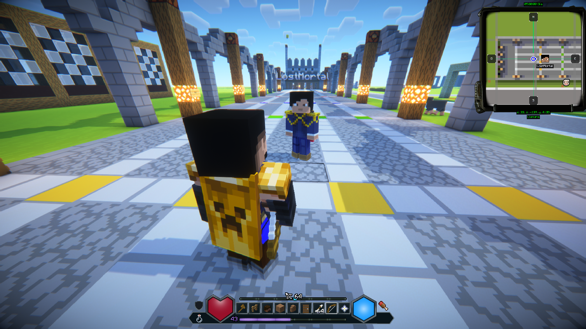
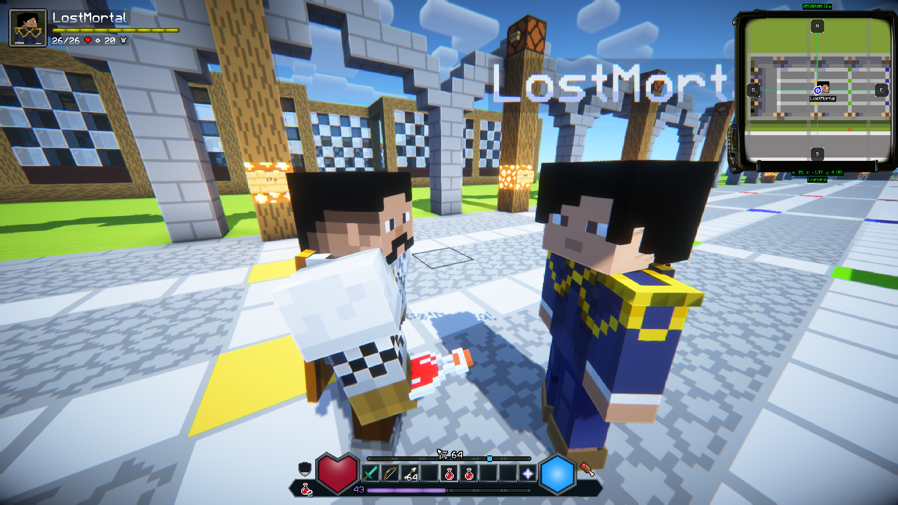
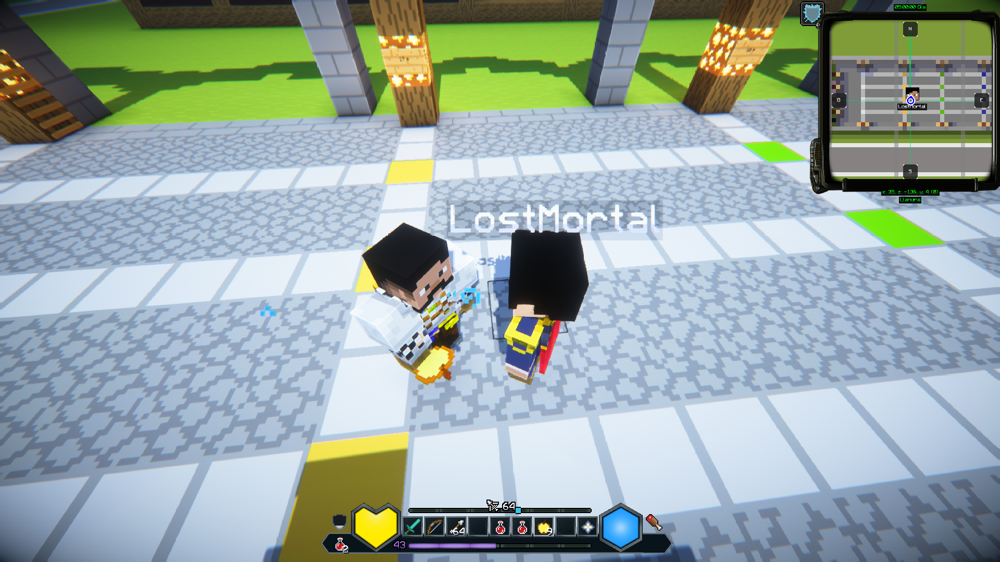
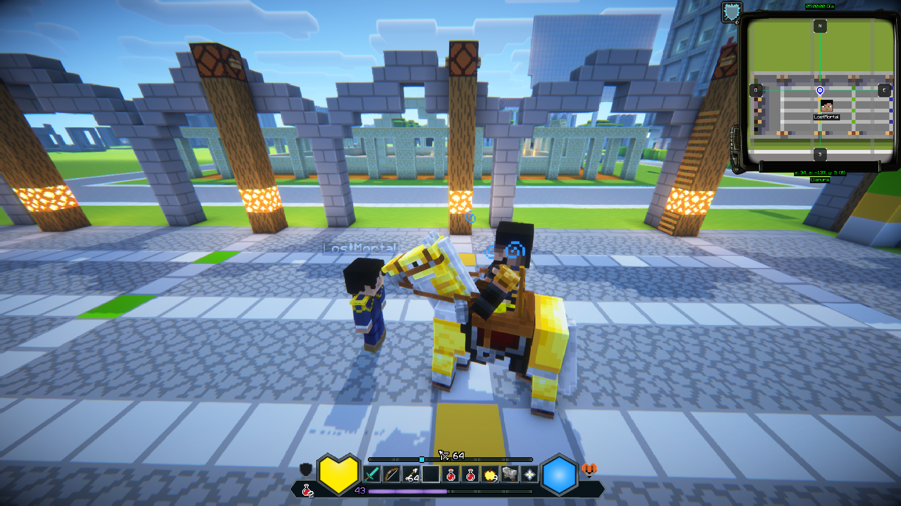
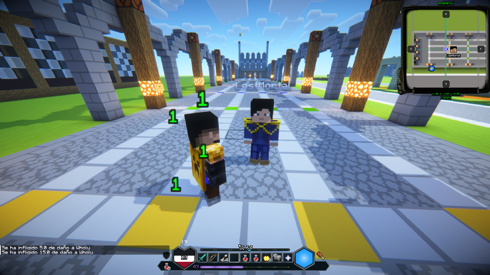
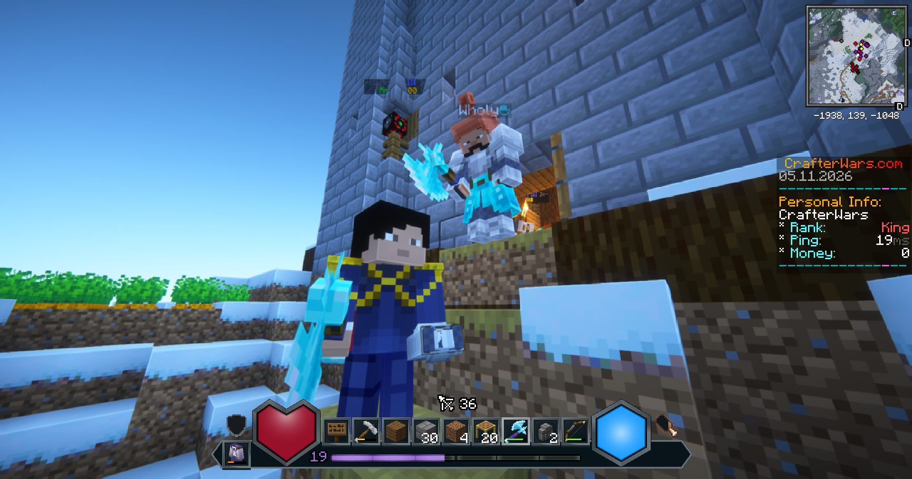

# DungeonsHUD

**A customizable Minecraft Dungeons II inspired HUD mod for Minecraft Java Edition 26.3.**

DungeonsHUD is a client-side Fabric mod for **Minecraft Java Edition 26.3** that redesigns the Minecraft interface with a customizable HUD inspired by Minecraft Dungeons II.

The project focuses on visual clarity, smooth animations, and configurable interface elements while preserving vanilla gameplay mechanics.

**DungeonsHUD is purely visual and does not affect gameplay or modify vanilla game mechanics.**

## Features

### Custom Hotbar

- Minecraft Dungeons-inspired Hotbar design.
- Full (9 slots) and Compact (3 slots) layouts.
- Animated slot selection.
- Custom offhand and potion indicators.

### Health, Armor & Hunger

- Custom HealthBar with smooth transitions and damage effects.
- Custom armor and hunger indicators.
- Health values and contextual notifications.
- Vehicle health indicator.

### SoulBar 

Two configurable modes:

- **Combat:** A visual 20-point combat resource that regenerates over time.
- **Durability:** Displays the durability of the selected item in main hand on a 0–10 scale.

### AmmoBar

- Arrow counter for bows.
- Detection of fireworks loaded into crossbows.
- Support for multiple charged crossbows.
- Animated ammunition updates and smooth transitions.

### Additional HUD Elements

- Experience and level indicator.
- Oxygen bar.
- Jumpable vehicle bar.
- Locator bar.
- Custom title and subtitle presentation.

### Customization

- Switch between Vanilla and Dungeons HUD.
- Change HUD scale.
- Select Hotbar layout.
- Adjust background opacity.
- Toggle selected HUD numbers.
- Choose SoulBar mode.

## Compatibility

- **Minecraft:** Java Edition 26.3
- **Mod Loader:** Fabric
- **Fabric API:** Required
- **Mod Menu:** Optional

## Installation

1. Install Fabric Loader for Minecraft Java Edition 26.3.
2. Install Fabric API.
3. Download the DungeonsHUD `.jar` from the [Releases](https://github.com/Lostmortal/DungeonsHUD/releases) page.
4. Place the `.jar` inside your Minecraft `mods` folder.
5. Launch Minecraft using the Fabric profile.

## Configuration

Open the in-game DungeonsHUD configuration screen using the **M** key.

Alternatively, install Mod Menu to access the configuration screen through the installed mods list.

Mod Menu is optional and is not required for DungeonsHUD to function.

## Screenshots

### In-Game Preview

Screenshots showcasing DungeonsHUD during gameplay.

## Downloads

Official builds will be available through [GitHub Releases](https://github.com/Lostmortal/DungeonsHUD/releases).

**Development status:** Work in progress.

## Future Plans

DungeonsHUD is an ongoing project, with plans to introduce further changes and improvements to the HUD interface in future updates.

These may include additional visual enhancements, redesigned interface elements, smoother animations, and more customization options.

Features and designs may evolve as development continues.

## Bug Reports & Feedback

If you encounter any bugs, visual glitches, or unexpected behavior while using DungeonsHUD, please report them through [GitHub Issues](https://github.com/Lostmortal/DungeonsHUD/issues).

When reporting a bug, please include your Minecraft version, a description of the issue, and screenshots if possible.

Feedback and suggestions are always welcome!

## Authors

- **LostMortal**
- **Wholy**

## Community

- [LostMortal Official Website](https://lostmortal.com/)
- [Wholy Official Website](https://wholy.tv/)
- [Discord Server](https://discord.com/invite/4uGXB8T)

## Disclaimer

DungeonsHUD is an independent, unofficial project and is not affiliated with, associated with, endorsed by, or officially connected to Mojang Studios, Microsoft, or any other entities involved in Minecraft or Minecraft Dungeons.

All product names and trademarks belong to their respective owners.
